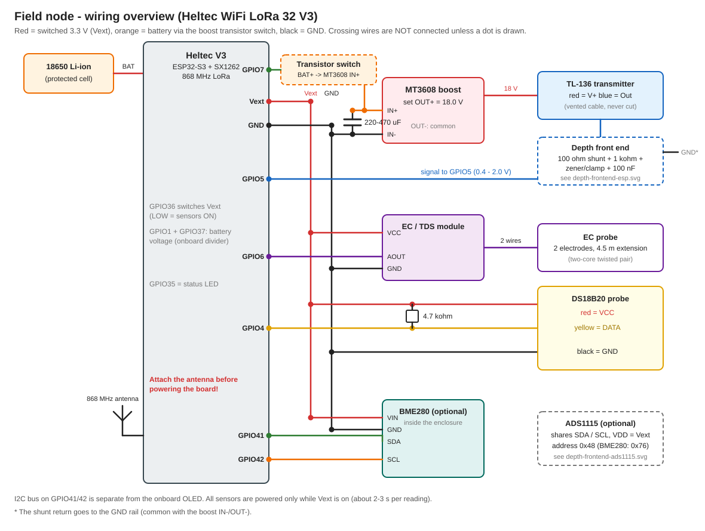

# Agricultural Groundwater Monitor (ESP32 + LoRa)

An open-source, low-cost citizen science hardware and software stack for monitoring **water table depth**, **groundwater temperature**, and **electrical conductivity (EC / fertilizer leaching)** under agricultural land.

Built around the **Heltec WiFi LoRa 32 V3 (ESP32-S3 + SX1262)**, battery-powered field nodes transmit hourly readings over raw LoRa (868 MHz) to a central gateway that feeds both **Home Assistant** and the public **openSenseMap** citizen science map.

> **Status:** the ESPHome configs pass `esphome config` validation (ESPHome 2026.10) and the CI workflow re-checks this on every push. They have **not yet been tested on hardware**. Please bench-test one node (see the Field Deployment Guide) and report what you find. See [`docs/CHANGES.md`](docs/CHANGES.md) for what changed after the technical review.

---

## Key Features
* **Water Table Depth (0-4 m):** industrial submersible hydrostatic pressure transmitter (TL-136, 0-5 m, 4-20 mA, vented cable).
* **Water Quality & Recharge:** waterproof DS18B20 temperature probe and an analog EC/TDS sensor with automatic 25 °C temperature compensation.
* **Enclosure/weather context (BME280, optional):** air pressure, plus temperature and humidity inside the box, which tells you when the desiccant is used up.
* **Long battery life:** the Heltec `Vext` rail (`GPIO36`) and a MOSFET switch for the boost converter (`GPIO7`) cut power to all sensors between readings. Expect roughly **1-2 years** from one 3000 mAh+ 18650, depending on your board's real sleep current. **Measure it** (see Field Guide, section 6); the estimate is not a guarantee.
* **Low-battery behaviour:** below 3.4 V a node only reports its battery voltage and sleeps 6 h.
* **Dual cloud & local output:** one farmhouse gateway receives packets from several wells and pushes them to **openSenseMap** and **Home Assistant**.
* **Gateway health and data quality:** per-well *Node Online*, *Water Below Sensor*, *QC Flags*, *Readings Lost* and *Node Resets* entities, plus an editable *Sensor Depth Below Ground* (no reflashing when you re-lower a probe). Raw voltages stay visible as diagnostic entities.
* **Calibration in the gateway:** the nodes send raw voltages; shunt value, zero, span and EC calibration are constants in the gateway file, so recalibrating never needs a visit to the well.

---

## Repository Structure

```text
agricultural-groundwater-monitor/
├── README.md                           # Project overview & quickstart
├── BOM.md                              # Shopping list (~€90-110/node)
├── LICENSE                             # MIT License
├── .gitignore                          # Excludes local secrets.yaml and build caches
├── .github/workflows/
│   └── esphome-validate.yml            # CI: validates all ESPHome configs
├── docs/
│   ├── field-deployment-guide.md       # Waterproofing, calibration, install, troubleshooting
│   ├── wiring.md                       # Depth-channel schematic, protection, pinout
│   ├── img/                            # Wiring and installation diagrams (SVG)
│   ├── REFERENCES.md                   # Sources for every technical claim, and open items
│   └── CHANGES.md                      # What was fixed after the technical review
├── esphome/
│   ├── secrets.yaml.example            # Template for Wi-Fi, keys & openSenseMap IDs
│   ├── sync-secrets.sh                 # Copies secrets.yaml next to every config
│   ├── gateway/
│   │   ├── water-well-gateway.yaml     # LoRa receiver + openSenseMap uploader
│   │   └── well-package.yaml           # Everything for ONE well (reused per well)
│   └── nodes/
│       ├── common-well-node.yaml       # Shared node firmware
│       ├── depth-adc-esp.yaml          # Depth ADC option 1: ESP32 built-in (default)
│       ├── depth-adc-ads1115.yaml      # Depth ADC option 2: external ADS1115
│       ├── water-well-node-example-ads1115.yaml  # Example node using the ADS1115
│       ├── water-well-node-1.yaml      # Node 1 settings
│       └── water-well-node-2.yaml      # Node 2 settings
└── home-assistant/
    ├── dashboard-card.yaml             # Lovelace cards for Well 1 and Well 2
    └── README.md
```

---

## Quickstart Guide

### 1. Gather Parts & Assemble Hardware
* Follow the **[Bill of Materials (`BOM.md`)](BOM.md)** (~€90-110 per field node, ~€25 for one gateway).
* Build the depth-channel front end exactly as in **[`docs/wiring.md`](docs/wiring.md)**: **100 Ω shunt**, 1 kΩ series resistor, 3.6 V zener clamp and 100 nF capacitor. The clamp protects the ESP32-S3 if the transmitter ever fails short onto its 18 V supply.
* Before submerging the EC and temperature probes, follow **Section 1 of the [Field Deployment Guide](docs/field-deployment-guide.md)** to waterproof the cable extensions.

#### Wiring diagrams


More detail: [depth channel (ESP32 ADC)](docs/img/depth-frontend-esp.svg), [depth channel (ADS1115)](docs/img/depth-frontend-ads1115.svg), [well installation](docs/img/well-installation.svg), and the notes in [`docs/wiring.md`](docs/wiring.md).

#### Heltec V3 Pinout Summary
*`GPIO1` reads the battery voltage. The divider is enabled by `GPIO37`: **LOW on V3/V3.1 boards, HIGH on V3.2** (set `vbat_ctrl_active_low` in the node file, see `docs/wiring.md`). `GPIO35` is the status LED.*

| Component | Pin / Wire | Heltec V3 Pin | Notes |
| :--- | :--- | :--- | :--- |
| **MT3608 Boost Input** | `VIN+` / `VIN-` | `BAT+` through the MOSFET switch / `GND` | Switched by `GPIO7` (HIGH = ON) through an AO3401 + 2N7002 stage (`docs/wiring.md`, section 2). Tune output to **18.0 V**. Add a 220-470 µF low-ESR capacitor across its input. |
| **TL-136 Depth Probe** | Red (`V+`) / Blue (`Out`) | MT3608 `VOUT+` / shunt node | **100 Ω 0.1 % shunt** from `Out` to `GND`; the shunt node goes through **1 kΩ** to `GPIO5` (see `docs/wiring.md`). |
| **EC / TDS Module** | `VCC` / `GND` / `AOUT` | `Vext` / `GND` / `GPIO6` | The *probe* has two electrode wires; only the module has three pins. |
| **BME280 (optional)** | `VIN` / `GND` / `SDA` / `SCL` | `Vext` / `GND` / `GPIO41` / `GPIO42` | 3.3 V module, I²C address `0x76` (or `0x77`; set `bme280_address`). Mount it inside the enclosure. |
| **DS18B20 Temp Probe** | `Red` / `Black` / `Yellow` | `Vext` / `GND` / `GPIO4` | **4.7 kΩ pull-up** between `Vext` and `GPIO4`. |

---

### 2. Register Your Well on openSenseMap
1. Create a free account at **openSenseMap.org** and click **New senseBox**.
2. Place your well's marker on the map and add three custom sensors:
   * **Water Table Depth** (Unit: `m`)
   * **Electrical Conductivity** (Unit: `µS/cm`)
   * **Groundwater Temperature** (Unit: `°C`)
3. Copy the generated **senseBox ID**, **Access Token**, and the three **Sensor IDs**.

---

### 3. Configure & Flash ESPHome Firmware
1. Copy `esphome/secrets.yaml.example` to `esphome/secrets.yaml` and fill it in (Wi-Fi, a shared LoRa passphrase, the Home Assistant API key, openSenseMap IDs, and the initial sensor depth of each well).
2. Run `esphome/sync-secrets.sh` (or copy the file by hand into `esphome/nodes/` and `esphome/gateway/`). **ESPHome only reads `secrets.yaml` from the folder of the config it builds.**
3. **Flash the gateway:** compile and upload `esphome/gateway/water-well-gateway.yaml` to your indoor Heltec V3 via USB-C.
4. **Flash a field node:** compile and upload `esphome/nodes/water-well-node-1.yaml`. Because the node sleeps right after each reading, hold **BOOT** while pressing **RST** to re-flash over USB later. Nodes have no Wi-Fi, so firmware updates need USB.

---

### 4. Calibrate & Deploy in the Well
Follow the **[Field Deployment & Calibration Guide](docs/field-deployment-guide.md)** to:
* Zero and span-check the depth channel and compare it with a manual dip meter. The calibration constants live in the **gateway** file, so a recalibration never needs a visit to the well.
* Perform a **two-point** EC calibration (for example 84 and 1413 µS/cm).
* Bundle the probes, hang them from a dedicated line, and measure the exact installation depth.
* Fit the TL-136 vent tube to a **breathable enclosure vent** with silica gel desiccant.

---

### 5. Optional: Home Assistant Dashboard
1. Adopt the auto-discovered `water-well-gateway` device under **Settings > Devices & Services > ESPHome** (use the `api_encryption_key`).
2. Paste `home-assistant/dashboard-card.yaml` into a manual dashboard card. Check the entity IDs first (see the comment at the top of that file).

---

## Adding more wells
One gateway can listen to several wells within LoRa range (typically 1-5 km across open farmland; less with the antenna close to the ground).

1. Duplicate `esphome/nodes/water-well-node-1.yaml` with a new `node_name`.
2. In `esphome/secrets.yaml` add the `well_N_*` entries.
3. In `esphome/gateway/water-well-gateway.yaml` add a `wN_*` substitution block (including the calibration values), a provider under `packet_transport:` and a package entry under `packages:` (copy the Well 2 lines).

Each node adds a random 0-30 s to its sleep time, so nodes do not stay locked on the same transmit moment.

## Sources
Settings, specifications and claims are traced to their sources in **[`docs/REFERENCES.md`](docs/REFERENCES.md)**, including a list of what could not be verified and the corrections found during the source check.

## Known limitations
* Duty cycle: one frame per hour is about 0.01 % airtime, far below the 1 % limit of the 868.0-868.6 MHz sub-band [R25][R22]; check your national rules.
* Single transmission per cycle, no acknowledgement: a lost frame is a lost reading (*Node Online* shows longer outages).
* `packet_transport` encryption is a shared passphrase without authentication. Treat the public openSenseMap feed accordingly.
* The EC curve is an approximation for a cheap analog probe; calibrate it and expect drift. Standing water in a piezometer is not necessarily representative of the aquifer.
* Depth accuracy with the ESP32 ADC is roughly a few centimetres; the optional ADS1115 (`depth-adc-ads1115.yaml`, see `docs/wiring.md`) improves resolution.
