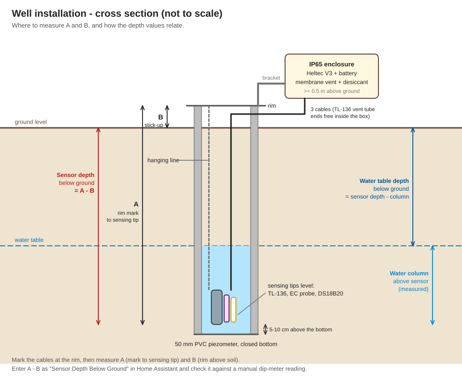

# Field Deployment & Calibration Guide

*`[R#]` tags refer to [REFERENCES.md](REFERENCES.md).*

This guide walks volunteers through waterproofing submerged sensor cables, bench-testing, calibrating, installing, and maintaining an agricultural groundwater monitoring node.

---

## 1. Waterproofing Submerged Cable Splices
The TL-136 depth probe comes with a 5 m+ factory-sealed **vented** cable, so **never cut or splice the TL-136 cable** (doing so can block its internal atmospheric vent tube). However, the **DS18B20** and **EC probe** cables are only ~1 m and must be extended to ~4.5 m using flexible waterproof rubber cable (such as 3x0.5 mm² H05RN-F).

* The **DS18B20** has three wires (`VCC`, `GND`, `Data`): all three cores are spliced.
* The **EC probe** is two stainless electrodes with **two wires**. Splice only those two (a twisted pair, or screened cable, is best because the signal is high-impedance). The module with `VCC/GND/AOUT` stays in the dry enclosure.

Because these splices sit underwater, follow the **Marine Triple-Seal Method**:

### Materials Needed
* **3:1 Dual-Wall Adhesive-Lined Heat-Shrink Tubing** (marine-grade; melts internal hot-melt glue when heated, not standard hobby heat-shrink).
* **Self-Amalgamating Silicone/Rubber Tape** (hardware stores like Hubo/Brico).
* **Flexible Rubber Cable** (4 m extension length per probe).

### Step-by-Step Splicing Procedure
1. **Slide tubing on first:** before soldering, slide one large outer piece of adhesive-lined heat-shrink (~10 cm long) onto the main extension cable, plus smaller pieces (~3 cm long) onto each individual inner wire.
2. **Stagger the cuts:** cut the inner wires at slightly staggered lengths (about 1.5 cm apart). This prevents a thick lump and ensures wires cannot short together.
3. **Solder & seal individual wires:** solder each wire pair cleanly, slide the small adhesive-lined heat-shrink over each joint, and shrink until a tiny ring of clear glue oozes out both ends.
4. **Wrap with self-amalgamating tape:** stretch the tape tightly around the entire staggered bundle, overlapping each turn by 50 % and extending 2 cm onto the original outer cable jackets. The tape fuses into a solid rubber block.
5. **Apply outer adhesive heat-shrink:** slide the large 10 cm tube over the rubber-wrapped joint and shrink it from the centre outward until hot-melt glue seals both ends onto the outer jackets.
6. **Submersion bucket test:** before lowering the probes into the well, coil the spliced sections in a bucket of tap water overnight and verify that EC and temperature readings remain stable.

---

## 2. Pre-Deployment Bench Checklist
Complete these steps indoors before heading out to the field well.

- [ ] **Boost converter:** with a multimeter, verify the MT3608 output reads **18.0 V DC** while `Vext` is active (the node's LED flashes at wake-up; the rail is on for about 2 s per cycle, so use a long `warmup` temporarily or a bench supply).
- [ ] **Shunt and protection:** confirm the **100 Ω shunt**, the **1 kΩ series resistor**, the **3.6 V zener** and the **100 nF capacitor** are wired as in `docs/wiring.md`. Measure the actual shunt value and set `shunt_ohm` if needed.
- [ ] **Boost input capacitor:** 220-470 µF fitted across the MT3608 input.
- [ ] **LoRa antenna attached:** **never power the Heltec V3 without the 868 MHz antenna screwed on**, or you risk damaging the SX1262 amplifier.
- [ ] **LED flash:** at power-on the node's LED flashes once per reading cycle.
- [ ] **First packet:** the gateway log (or Home Assistant) shows readings for the node within a couple of minutes. If nothing arrives, check that both devices use the same `lora_encryption_key`.
- [ ] **Battery reading:** compare *Battery Voltage* with a multimeter; adjust `vbat_scale` if it is off by more than about 2 %.
- [ ] **BME280 (if fitted):** *Air Pressure* about 950-1050 hPa, *Enclosure Humidity* and *Enclosure Temperature* plausible.
- [ ] **Dry depth test:** with the TL-136 hanging in air, *Water Column Height* should read **0.00 m (±0.02 m)**. If it is offset, set `zero_offset_m` in the node file to the negative of the reading (see section 3.1).
- [ ] **Silica gel + breather vent:** fit the membrane vent plug on the enclosure and a fresh 10-20 g silica gel pack inside.

---

## 3. Calibration

### 3.1 Depth channel: zero and span
Edit the values in `esphome/nodes/water-well-node-N.yaml` and re-flash.

1. **Zero (in air):** read *Water Column Height* with the probe dry. Set `zero_offset_m` to the negative of that reading (reading 0.014 m → `zero_offset_m: "-0.014"`).
2. **Span (in water, optional but recommended):** hang the probe in a tall container (a pipe or a deep bucket) at two known water heights above the sensor, e.g. 0.50 m and 1.50 m measured with a ruler. Note the two readings (with the new zero). Then `span_scale = (1.50 - 0.50) / (reading2 - reading1)`. Typical values are within 0.99-1.01.
*(With the optional ADS1115 the procedure is identical; only the wiring and the `depth-adc-ads1115.yaml` include differ, see `docs/wiring.md`.)*

3. **Field check:** after installation, compare *Water Table Depth Below Ground* with a manual dip-meter reading. Repeat at least once per season. A persistent difference means a wrong *Sensor Depth Below Ground* (Home Assistant number entity) or an offset.

### 3.2 EC sensor: two-point calibration
Cheap analog EC/TDS probes vary from batch to batch, and the longer cable changes the response. Calibrate each probe *after* extending its cable. Set `ec_gain: "1.0"` and `ec_offset: "0.0"` first so you read the raw value.

1. **Rinse & dry:** rinse the probe tips with distilled water and blot dry.
2. **Low standard:** place the **EC probe and the DS18B20** in **84 µS/cm** solution; swirl to remove air bubbles; wait 60 s. Trigger a reading (press **RST** once) and note the reported *Electrical Conductivity* as `M1`.
3. **High standard:** rinse and repeat with **1413 µS/cm**, giving `M2`.
4. **Calculate:**
   `ec_gain = (1413 - 84) / (M2 - M1)`
   `ec_offset = 84 - ec_gain × M1`
5. Put both numbers in the node file, re-flash, and verify that both standards now read correctly.

*Single-point fallback (only 1413 µS/cm available):* `ec_gain = 1413 / M`, `ec_offset = 0`. This is less accurate, especially at low conductivity.

Note: the DFRobot analog sensor is specified for 0-1000 ppm TDS (about 0-2000 µS/cm at the usual 0.5 factor) with an accuracy of ±10 % of full scale at 25 °C [R19]. Treat readings above that range as "high", not as precise numbers, and expect a few hundred µS/cm of uncertainty even after calibration.

---

## 4. Well Installation Procedure

### Step 1: Bundle the Sensor Array
1. Lay the **TL-136 pressure sensor**, **EC probe**, and **DS18B20** side-by-side so their sensing tips are at the same height.
2. Secure them with **two UV-resistant zip ties** around the stainless body of the TL-136. *(Do not cover the perforated end cap of the TL-136 or the metal pins of the EC probe. Keep the EC electrodes a few cm clear of the TL-136 body.)*
3. Attach the **hanging line** (stainless wire or Kevlar) to the bundle and carry the weight on it, **not on the cables** (stretching can damage the TL-136 vent tube).

### Step 2: Measure Exact Sensor Depth

1. Lower the bundle down the 2-inch (50 mm) PVC piezometer pipe until the TL-136 rests gently on the bottom, then pull it up **5 cm to 10 cm** so it hangs clear of mud and silt.
2. Mark the line/cables at the **top rim of the PVC casing** with tape.
3. Measure with a tape:
   * **A:** length from the sensing tip to the tape mark at the rim.
   * **B:** height of the casing rim above the surrounding soil ("stick-up height").
4. **Sensor Depth Below Ground (m) = A - B**
5. Enter this in Home Assistant under the gateway device as **"Well N Sensor Depth Below Ground"**. (The value in `secrets.yaml` is only the starting value; changing the number in Home Assistant needs no reflashing.)
6. **Dip-meter check:** take a manual water-level reading from the casing rim at install time and compare it with the sensor (see 3.1).

### Step 3: Route Cables & Mount Enclosure
1. Pass the three sensor cables through the waterproof **PG9/PG11 cable glands** at the bottom of the IP65 box and tighten them firmly.
2. **Critical vent tube check:** the TL-136 cable has a tiny clear hollow tube alongside the wires. Make sure it is **not pinched, kinked, or sealed** with glue or heat-shrink. It must end freely **inside the box** next to the desiccant, and the box needs the **membrane vent plug** so its air pressure follows the atmosphere.
3. Mount the box on the casing or a post at least **0.5 m above ground** (clear of splash, better LoRa line of sight).
4. Connect the battery, check that the LED flashes at wake-up, and close the lid.
5. Check that the gateway receives the first packet before you leave the site.

---

## 5. Field Troubleshooting Matrix

| Symptom | Likely Cause | Field Fix |
| :--- | :--- | :--- |
| **Depth reads `unavailable`** | Shunt current outside 3.5-22 mA (0.35-2.2 V across 100 Ω). | Check battery charge, MT3608 output (18 V), and the red/blue wires and the shunt/zener network. |
| **Depth looks wrong by a constant amount** | Wrong zero or sensor depth. | Redo 3.1 and the dip-meter check; correct *Sensor Depth Below Ground*. |
| **Depth equals the sensor depth exactly and *Water Below Sensor* is on** | The water level is at or below the probe. | Genuine dry well, or the probe was installed too high. Lower the probe if possible. |
| **Depth drifts slowly with weather** | Vent tube blocked or wet; sealed enclosure. | Open the box, check the tube, fit/clean the breather vent, replace saturated silica gel. |
| **EC reads erratically or spikes after submerging** | Water in the cable splice, or mud on the prongs. | Pull up, inspect the splice, re-seal, clean the prongs. |
| **EC reads too low or too high everywhere** | Uncalibrated probe or longer cable. | Redo 3.2. |
| **Temperature `unavailable`** | DS18B20 disconnected, water in the splice, or missing 4.7 kΩ pull-up. The EC calculation then falls back to 12 °C. | Check `GPIO4` wiring, the splice and the pull-up. |
| **BME280 values `unavailable`** | Not fitted, wrong address, loose I²C wire, or a BMP280 (no humidity). | Check `GPIO41/42`, try `bme280_address: "0x77"`, check the chip. |
| **Enclosure humidity above ~60 %** | Saturated silica gel or a leaking gland/lid. | Replace the desiccant, check seals and the vent plug. |
| **No data from a node** | Out of range, loose antenna, key mismatch, or flat battery. | Check the antenna, move the gateway closer to a window, verify `lora_encryption_key` is identical everywhere, check the battery. |
| **Gateway shows *Node Online = off*** | No packet for 2.5 h. | Same as above; also look for a battery below 3.4 V (the node then sends only its voltage every 6 h). |
| **Battery reads 0 V or nonsense** | `GPIO37` polarity (depends on the board revision: V3/V3.1 LOW, V3.2 HIGH) or wrong divider factor. | Set `vbat_ctrl_active_low` for your revision (see `docs/wiring.md`, "Board revision check"); adjust `vbat_scale` against a multimeter. |
| **Data in Home Assistant but not on openSenseMap** | Wrong box ID, sensor ID or token. | Check the gateway log for *openSenseMap upload failed* and the HTTP status. The token is sent as-is in the `Authorization` header. |

---

## 6. Power Budget Check (once per design)
The battery-life figure depends heavily on your board's real sleep current and on how long the boost converter runs.

1. Measure the deep-sleep current with a µA-capable meter in series with the battery (expect tens to a few hundred µA on a Heltec V3; Heltec quotes under 10 µA for a related board [R15], treat that as a best case). If it is above about 100 µA, battery life will be mostly limited by sleep current.
2. Measure how long the 4-20 mA reading takes to settle and shorten `warmup` accordingly.
3. Estimate: yearly mAh = (active mA × active s ÷ 3600 × readings per year) + (sleep mA × 8760). Compare with ~80 % of the cell's rated capacity (less in cold climates).

---

## 7. Annual Volunteer Maintenance
* **Spring & Autumn:** open the junction box, swap the silica gel, check the breather vent, and check battery voltage on the dashboard (recharge or replace below **3.4 V**).
* **Once per year:** pull the sensor bundle, inspect zip ties, the hanging line and cable splices, and gently rinse clay or biofilm off the EC prongs and TL-136 nose cone with clean water. Do not scrub the TL-136 diaphragm with brushes or sharp tools.
* **Each visit:** take a manual dip-meter reading and note the difference from the sensor.
* **EC probe:** recalibrate yearly and replace when it will not hold calibration.
