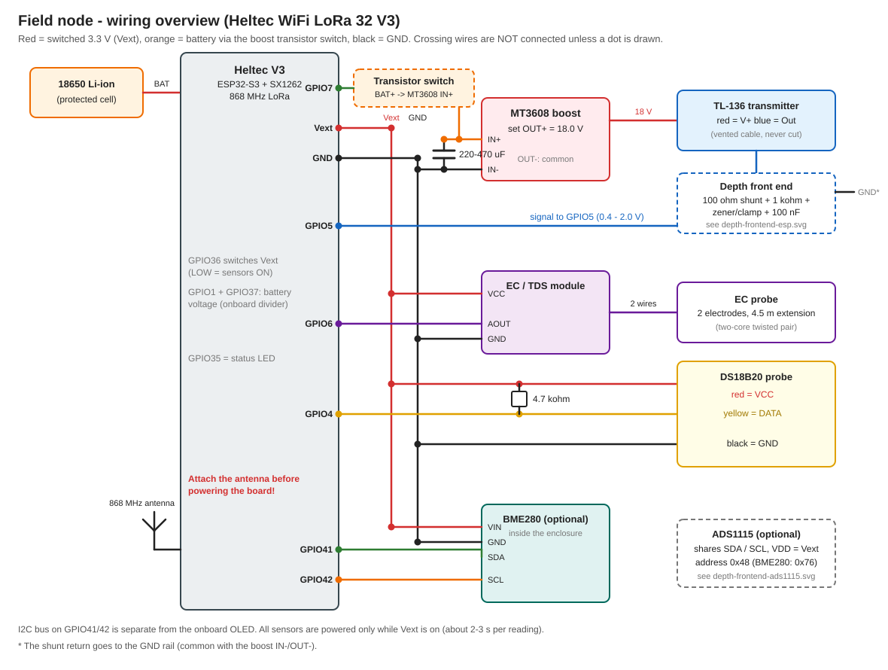
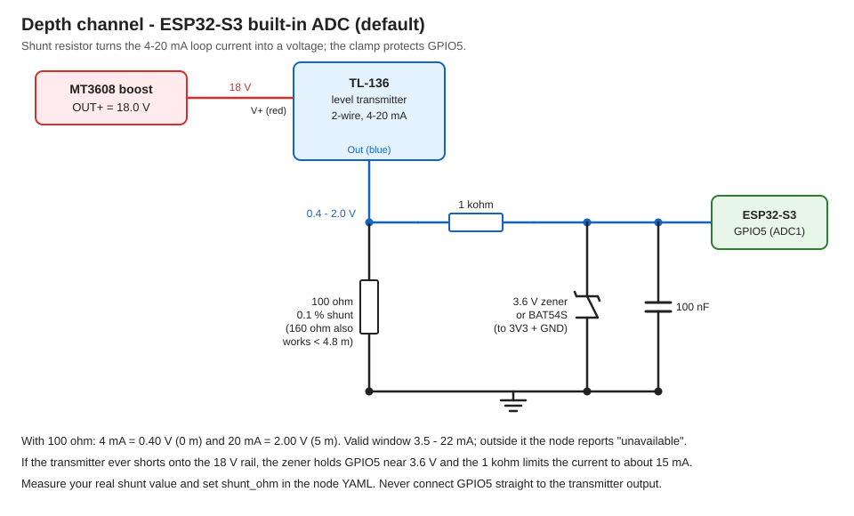
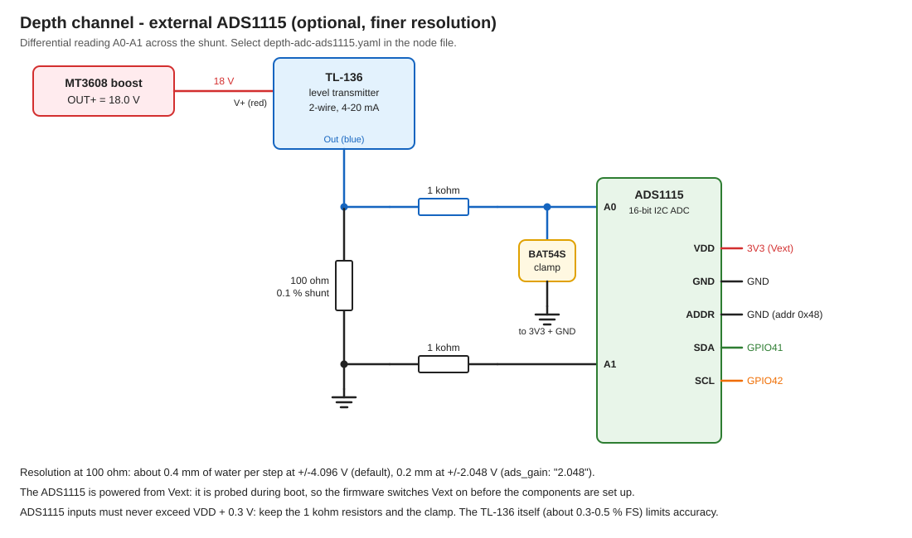
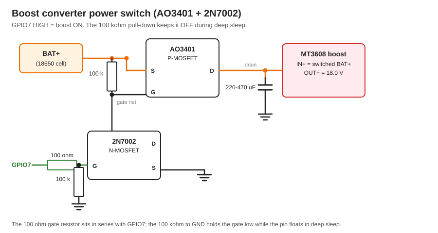

# Wiring Notes: Depth Channel, Power and Pinout

*`[R#]` tags refer to [REFERENCES.md](REFERENCES.md).*

> Not yet tested on hardware. Build one node on the bench and check every voltage before connecting the transmitter in a well.

## Overview: whole node



*Red = switched 3.3 V (`Vext`), black = GND. Crossing wires are not connected unless a dot is drawn. Diagram sources are plain SVG files in `docs/img/`.*

## 1. Depth channel (TL-136, 4-20 mA loop)




* Voltage across the shunt: 4 mA = 0.40 V (0 m), 20 mA = 2.00 V (5 m). This stays inside the ESP32-S3 ADC range, unlike 160 Ω (3.2 V).
* The **1 kΩ + zener** protect `GPIO5`. If the transmitter fails short onto the 18 V rail, the zener clamps the pin near 3.6 V and the 1 kΩ limits the current (about 15 mA). Without them an ESP32-S3 pin would see up to 18 V.
* Check the zener's leakage near 2 V (should be negligible). If the reading at 20 mA is more than about 10 mV low, use a TVS or a BAT54S Schottky clamp (one diode to `GND`, one to `3V3`) instead.
* The **gateway** converts the shunt voltage (sent raw by the node) to current with `wN_shunt_ohm` (default 100.0). Measure your actual resistor and set `w1_shunt_ohm: "100.3"` (for example) in `esphome/gateway/water-well-gateway.yaml`.
* **Valid range:** 3.5 mA to 22 mA. Outside it the node reports *unavailable* (broken wire, short, boost fault).

### Optional: ADS1115 for the depth channel (built into the firmware)



The ESP32-S3 ADC reads up to about 3.1 V at 12 dB attenuation [R17], is less accurate near the top of that range, and its reference voltage varies between 1000 and 1200 mV from chip to chip [R16]. In practice that means tens of mV of error, which is roughly a few cm of water (my estimate; ESPHome gives no accuracy figure [R3]). An **ADS1115** (16-bit, I²C, about €4) reads the same shunt differentially (A0-A1) and brings the converter error down to about a millimetre. The TL-136 itself (typically 0.3-0.5 % of full scale, about 1.5-2.5 cm) then becomes the limit.

1. Wire it as in the diagram: `VDD` to `Vext`, `GND` and `ADDR` to `GND` (address `0x48`), `SDA` to `GPIO41`, `SCL` to `GPIO42` (shared with the BME280, which is `0x76`). Do **not** connect `GPIO5` any more.
2. Keep the 1 kΩ series resistors and the clamp: the ADS1115 inputs must stay within `GND - 0.3 V` to `VDD + 0.3 V` [R18].
3. In your node file (`water-well-node-N.yaml`) swap the depth ADC line:
   ```yaml
   packages:
     base: !include common-well-node.yaml
     # depth_adc: !include depth-adc-esp.yaml
     depth_adc: !include depth-adc-ads1115.yaml
   ```
   `water-well-node-example-ads1115.yaml` shows a complete node.
4. Range: `ads_gain: "4.096"` (default) works for 100 Ω and 160 Ω; with 100 Ω you can use `"2.048"` for twice the resolution (full-scale +/-2.048 V, the signal peaks at 2.0 V).

### Using a 160 Ω shunt instead
It works if your water column stays below about 4.8 m (the ESP32-S3 ADC saturates near 3.1 V [R17][R3], which is about 19.5 mA). Set `wN_shunt_ohm: "160.0"` in the gateway file. Trade-offs: the top of the range is less linear, a fault current above about 19.5 mA reads as the maximum instead of "unavailable", and the 3.6 V zener sits close to the 3.2 V full-scale signal, so prefer a **BAT54S Schottky clamp** (one diode to `GND`, one to `3V3`). With the ADS1115 (±4.096 V range) 160 Ω also works, but 100 Ω leaves more margin.

## 2. Power



```text
18650 --> Heltec battery connector --> 3.3 V regulator --> Vext switch (GPIO36 LOW = ON)
   |                                                          |
   |                                +-------------------------+-----------+
   |                                |                         |           |
   |                             EC module    DS18B20 (+4.7 k pull-up)  BME280 / ADS1115
   |
   +--> AO3401 P-MOSFET switch (gate driven by 2N7002, GPIO7 HIGH = ON)
            |
        [220-470 uF] + MT3608 IN --> MT3608 OUT = 18.0 V --> TL-136 V+
```

* **Why a separate switch:** the MT3608 now runs from the **battery** through its own MOSFET, not from `Vext`. The loop is the biggest load: 20 mA at 18 V is about 0.36 W, which at roughly 85 % boost efficiency (my assumption) is about 130 mA from 3.3 V or about 115 mA from a 3.7 V cell. Feeding it from `Vext` puts that current through the board's 3.3 V regulator and Vext switch, whose current rating I could not confirm; feeding it from the battery avoids that, and the loop can be switched without the probes. Idea and circuit taken from the Meetbeek set (P-MOSFET + N-MOSFET stage). The old design ran the MT3608 input from `Vext`; if you built that, move the MT3608 input to the MOSFET output and wire `GPIO7`.
* **Switch circuit:** `BAT+` to the AO3401 **source**; AO3401 **drain** to the MT3608 `IN+`; AO3401 **gate** to `BAT+` through 100 kΩ, and to the 2N7002 **drain**; 2N7002 **source** to `GND`; 2N7002 **gate** to `GPIO7` through 100 Ω, with a 100 kΩ pull-down to `GND`. `GPIO7` HIGH turns the boost converter on; during deep sleep the pull-down keeps it off.
* **The MOSFET is a part to verify:** the AO3401 must have a gate threshold below about 1.5 V at `Vgs = -3 V` so it is fully on at a 3.0 V battery. Check its datasheet for `Rds(on)` at `Vgs = -2.5 V` (it is specified for 2.5 V operation). Test the switched-off state with a multimeter: the MT3608 `IN+` must be 0 V while the node sleeps.
* The 220-470 µF capacitor at the boost input is a precaution against the start-up current spike browning out the ESP32. The MT3608 has internal soft start [R20], so this is a cheap safeguard rather than a fix for a known fault.
* The TL-136 is listed with a 12 to 32 V supply [R21]; at 18 V a 160 Ω shunt (3.2 V at 20 mA) still leaves about 14.8 V. Check the label of your unit.
* Set the MT3608 to 18.0 V **before** connecting the TL-136, and re-check after transport (the trimmer drifts).
* `Vext` and the boost switch are both turned on very early at boot (before the sensors are set up), because the BME280, ADS1115 and DS18B20 are detected once during start-up and must already have power.
* Active energy is dominated by the boost converter. Keep the `warmup` time as short as the transmitter allows (measure how fast the reading settles; the default is 1000 ms, the Meetbeek set waits 3 s).

## 3. Pin summary

| Function | Heltec V3 pin | Notes |
| :--- | :--- | :--- |
| Vext enable | `GPIO36` | LOW = sensor rail ON |
| Boost switch | `GPIO7` | HIGH = MT3608 input powered, via 2N7002 + AO3401 |
| Depth signal | `GPIO5` (ADC1) | via 1 kΩ, zener, 100 nF |
| EC signal | `GPIO6` (ADC1) | analog module output |
| DS18B20 data | `GPIO4` | 4.7 kΩ to `Vext` |
| BME280 SDA / SCL | `GPIO41` / `GPIO42` | separate I²C bus from the onboard OLED; powered from `Vext` |
| Battery ADC | `GPIO1` | divider 390 k / 100 k (factor 4.9) |
| Battery divider enable | `GPIO37` | V3 / V3.1: **LOW** connects the divider; **V3.2: HIGH** [R11][R13]. Set `vbat_ctrl_active_low` |
| Status LED | `GPIO35` | flashes once at every wake-up |
| LoRa SX1262 | `GPIO8/9/10/11/12/13/14` | onboard; `tcxo_voltage: 1_8V`, `rf_switch: true` |

Check the battery reading against a multimeter once. If it is off, adjust `vbat_scale` in the node file (default 4.9; a 390 k / 100 k divider [R12], while ESPHome's device page uses 2.0 [R10]).

### Board revision check (do this once per board)
The polarity of two pins differs between Heltec V3 revisions, and the firmware has two settings for it:

| Setting in the node file | V3.0 / V3.1 | V3.2 | Source |
| :-- | :-- | :-- | :-- |
| `vbat_ctrl_active_low` (GPIO37) | `"true"` | `"false"` (default) | [R11] [R13] |
| `vext_active_low` (GPIO36) | `"true"` (default) | **not confirmed**, check | [R10] [R11] [R14] |

1. Read the revision printed on the board (V3.2 is the current one).
2. Battery: with the battery connected and the node awake, *Battery Voltage* should match a multimeter within a few percent after adjusting `vbat_scale`. A reading near 0 V means the polarity is wrong (the firmware then ignores the reading and carries on measuring).
3. Vext: measure between the `Ve` pin and `GND` while the node is awake (it switches `Vext` on in early boot). About 3.3 V means the setting is right. If it reads 0 V, flip `vext_active_low`. Compare with the V3.2 schematic [R14] if in doubt.
4. A cleaner test: flash a minimal config that only toggles `GPIO36` and `GPIO37` from two buttons or switches, and watch the voltages.


## 4. Enclosure
* The TL-136 vent tube must reach **atmospheric pressure**. A sealed box warms in the sun and changes its internal pressure (1 hPa is about 1 cm of water). Fit a **membrane vent plug** to the enclosure and keep the vent tube open inside it, together with a desiccant packet.
* Never put the antenna's U.FL connector in contact with water; **never power the board without the antenna attached**.

## 5. BME280 (optional)
* Wire `VIN` to `Vext`, `GND` to `GND`, `SDA` to `GPIO41`, `SCL` to `GPIO42`. It is powered only during a reading.
* It sits **inside the enclosure**, so it reports the air in the box, not the outdoor weather: expect the temperature to run warmer than outside in the sun. Its pressure is useful as the ambient reference (and shows if the box is really breathing through the vent plug); its humidity tells you when the silica gel is saturated.
* Many cheap modules sold as "BME280" are really BMP280 (no humidity). If *Enclosure Humidity* stays unavailable, check the chip marking.
* If the module's address pin is wired high the address is `0x77`; set `bme280_address: "0x77"` in the node file.
* The same I²C bus can later carry an ADS1115 (address `0x48`).
