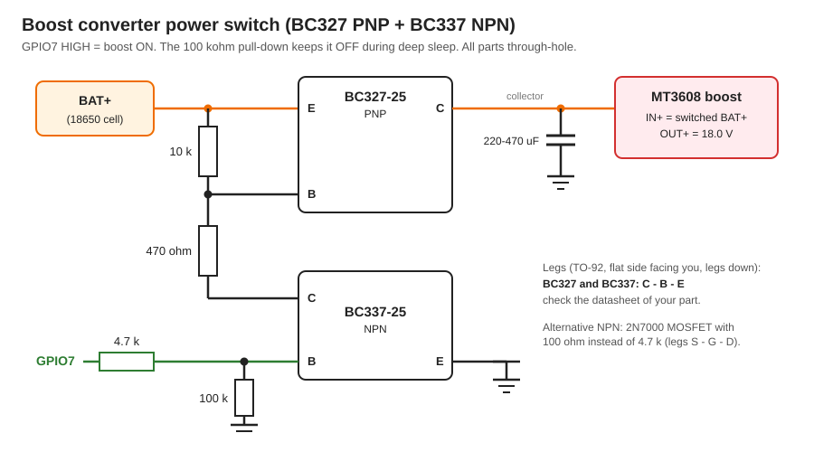
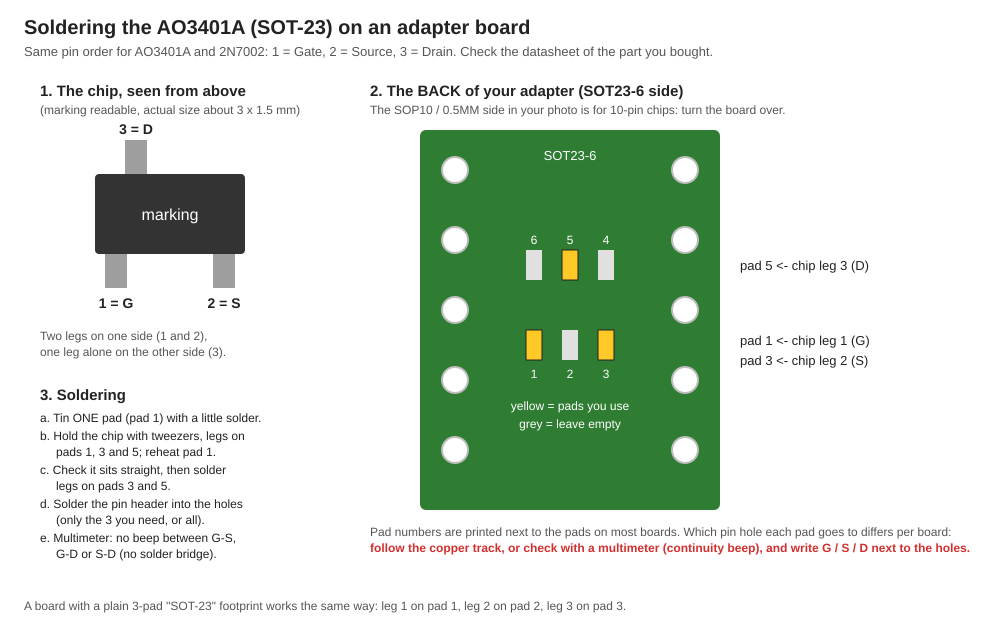

# Boost converter switch (BC327 PNP + BC337 NPN)

Used by `groundwater/` and `brook/lite/`. Firmware: [`shared/esphome/heltec-v3/boost-switch.yaml`](../esphome/heltec-v3/boost-switch.yaml) (`GPIO7`, output `boost_power`). All parts are ordinary through-hole parts with normal legs; no SMD, no adapter boards.

## Why

The TL-136 needs 18 V, made by an MT3608 boost converter. The 4-20 mA loop is the largest load of the node: 20 mA at 18 V is about 0.36 W, which at roughly 85 % efficiency (an assumption) is about 115-130 mA from the cell.

* Fed from `Vext`, that current runs through the Heltec's 3.3 V regulator and Vext switch, which also power the ESP32 and the radio, and whose current rating I could not confirm.
* Fed from the battery through its own switch, the boost converter is **on only while the level is read** (about 1 s per cycle), the battery is read **without** the loop load, and the EC probe is read while **no loop current** is present.

## Circuit

| From | Part | To |
| :--- | :--- | :--- |
| `BAT+` | BC327 **emitter** (E) | |
| BC327 **collector** (C) | | MT3608 `IN+` (and the 220-470 µF capacitor to `GND`) |
| BC327 **base** (B) | 10 kΩ | `BAT+` (keeps the PNP off) |
| BC327 **base** (B) | 470 Ω | BC337 **collector** (C) |
| BC337 **emitter** (E) | | `GND` |
| `GPIO7` | 4.7 kΩ | BC337 **base** (B) |
| BC337 **base** (B) | 100 kΩ | `GND` (keeps everything off in deep sleep) |

`GPIO7` HIGH: the BC337 conducts and pulls about 5-7 mA out of the BC327 base, so the BC327 is fully on (saturated) and the battery reaches the boost converter with about 0.1-0.2 V loss. `GPIO7` LOW or floating: both transistors are off; leakage is negligible.

The numbers: base current of the BC327 = (3.0...4.2 V - 0.8 V) / 470 Ω ≈ 4.7-7 mA. For 130 mA that is a "forced gain" of about 20-28, well below the BC327-25's current gain (160-400), so it saturates even with a nearly empty cell. The extra 5-7 mA flows only during the ~1 s the boost converter is on: negligible. The BC327 also limits the switch-on current into the 470 µF capacitor, which is gentle on the battery.

## Parts (Otronic has all of them)

| Part | Value | Where |
| :--- | :--- | :--- |
| PNP transistor | **BC327-25** (or -40), TO-92, 800 mA | [Otronic](https://www.otronic.nl/en/pnp-transistor-bc327-25-45v-800ma-100mhz-625mw-to.html), [Reichelt](https://www.reichelt.com/de/en/transistor-pnp-to-92-45-v-0-8-a-0-625-w-bc-327-25-p4980.html) |
| NPN transistor | **BC337-25**, TO-92 | [Otronic transistors](https://www.otronic.nl/en/transistors) ("NPN Transistor BC337-25", €0.35) |
| Resistors | 10 kΩ, 470 Ω, 4.7 kΩ, 100 kΩ (0.25 W) | [10 kΩ](https://www.otronic.nl/en/10x-resistor-10k-ohm-1-4-watt-5-pull-up-pull-down.html), [470 Ω](https://www.otronic.nl/en/10x-resistor-470-ohm-1-4-watt-5), [4.7 kΩ](https://www.otronic.nl/en/10x-resistance-4k7-ohm-1-4-watt-5.html), [100 kΩ](https://www.otronic.nl/en/10x-resistor-100k-ohm-1-4-watt-5.html) |

**Legs** (TO-92, flat side with the text facing you, legs pointing down): **BC327 and BC337: C - B - E** (collector left, base middle, emitter right). Check the datasheet of the parts you bought; some makers differ.

Alternatives:
* **NPN side:** a **2N7000** MOSFET works too ([TinyTronics](https://www.tinytronics.nl/en/switches/transistors-and-mosfets/mosfets-fets/2n7000-fet-60v-200ma)): use **100 Ω** instead of the 4.7 kΩ; its legs are usually **S - G - D**.
* **PNP side:** a logic-level P-MOSFET (e.g. AO3401A, SMD) has a slightly lower loss, but it only exists as a tiny SMD part and needs an adapter board; see the note at the end. Common through-hole P-MOSFETs such as the IRF9540, IRF5305 or IRF4905 do **not** work: they need -4 to -10 V on the gate and stay half on at a 3-4 V battery.

## Bench test (before connecting the TL-136)

1. Node asleep (`GPIO7` LOW): MT3608 `IN+` reads **0 V**.
2. While the node measures (or with `GPIO7` tied to 3.3 V on the bench): MT3608 `IN+` reads the battery voltage minus at most about 0.2 V, and the MT3608 output **18.0 V**.
3. If `IN+` is clearly lower (more than 0.3 V below the battery) under load, check the BC327 legs and the 470 Ω.

## Note: the SMD option (AO3401A)

Earlier versions of this guide used an AO3401A P-MOSFET (SOT-23, SMD) with a 2N7002/2N7000 driver. It still works if you already have one: `BAT+` to source, drain to MT3608 `IN+`, 100 kΩ gate to `BAT+`, gate to the 2N7000 drain, 2N7000 gate to `GPIO7` through 100 Ω with 100 kΩ to `GND`. To solder the SOT-23 part on a SOT23-6 adapter (for example one from the [TinyTronics adapter set](https://www.tinytronics.nl/en/tools-and-mounting/prototyping-supplies/breakout-boards/so-8-tssop8-msop8-sot23-6-sc70-sot563-to-dip-adapter-6-types)): leg 1 (G) on pad 1, leg 2 (S) on pad 3, leg 3 (D) on pad 5, and check with a multimeter which hole each pad goes to.

